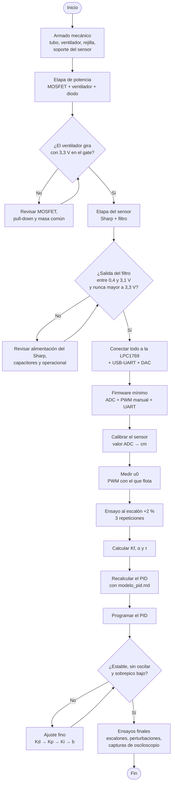
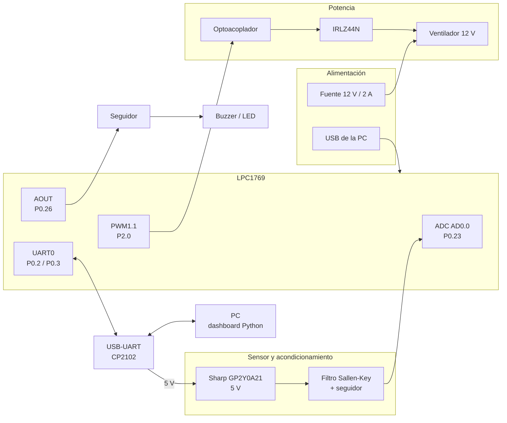

# Armado del TP

Este documento describe el armado del levitador (estructura mecánica y circuito), las pruebas realizadas en cada etapa y el procedimiento para medir los parámetros de la planta que se usan en [modelo_pid.md](modelo_pid.md).

## Orden de armado



Cada etapa del circuito se probó por separado antes de conectarla a la LPC1769, para no exponer la placa a un error de cableado.

Estado actual: etapa de potencia, PWM, medición de u0 y comunicación UART terminados. La lectura del sensor por ADC está en prueba.

## Diagrama de bloques



## Conexiones

| Señal | Pin LPC1769 | Conector LPCXpresso | Se conecta a |
|---|---|---|---|
| Entrada del ADC (altura) | P0.23 (AD0.0) | J6-15 | salida del filtro, a través de 1 kΩ |
| PWM del ventilador | P2.0 (PWM1.1) | J6-42 | entrada del optoacoplador, a través de 470 Ω |
| Salida del DAC | P0.26 (AOUT) | J6-18 | entrada del seguidor |
| UART TX | P0.2 (TXD0) | J6-21 | RX del CP2102 |
| UART RX | P0.3 (RXD0) | J6-22 | TX del CP2102 |
| 3,3 V | VIO 3V3 | J6-28 | alimentación del operacional (si es rail-to-rail) |
| GND | GND | J6-1 | masa común |

La numeración del conector J6 corresponde a la LPCXpresso LPC1769; conviene verificarla con el diagrama de la placa antes de cablear.

## Alimentación

| Tensión | Origen | Carga |
|---|---|---|
| 12 V | fuente externa de 12 V / 2 A | ventilador |
| 5 V | pin 5V del CP2102 (USB) | sensor Sharp (~30 mA) y operacional si es LM358 |
| 3,3 V | salida de 3,3 V de la LPC1769 | operacional si es rail-to-rail (MCP6002 / LMV358) |

Todas las masas están unidas. Antes de conectar la LPC se verificó con el tester que no hubiera 12 V en ningún cable que llegue a la placa.

## Etapa 1: potencia

### Circuito con conexión directa

Es el primer circuito que se armó y con el que se validó el funcionamiento del ventilador:

```text
                         +12 V
                           │
                 ┌─────────┤
                 │         │
          1N4007 ▲      ┌──┴───┐
         (cátodo │      │VENTI-│
          a +12V)│      │LADOR │
                 │      └──┬───┘
                 └─────────┤ Drain
                           │
  P2.0 ──[ 220 Ω ]──┬─── Gate   IRLZ44N
                    │      │
                 [ 10 kΩ ] │ Source
                    │      │
  GND ──────────────┴──────┴──── GND (común con la fuente de 12 V)
```

- La resistencia de 220 Ω limita el pico de corriente al cargar el gate.
- La de 10 kΩ entre gate y source mantiene el MOSFET apagado mientras la LPC arranca y el pin está flotando.
- El diodo va en antiparalelo con el ventilador, con el cátodo hacia +12 V, y absorbe la tensión inducida por el motor al apagarse el MOSFET. Se usó un 1N4007; un 1N5819 (Schottky) es preferible a frecuencias altas por su menor tiempo de recuperación. Un zener como el 1N4728A no sirve para esta función, porque conduce en inversa a 3,3 V y pondría en cortocircuito la fuente.
- Capacitor de 10 µF entre +12 V y GND, cerca del ventilador.

En la protoboard, el circuito se armó en las filas A–E. El riel positivo de ese lado lleva los 12 V; el riel positivo del lado F–J no se usa para 12 V y queda reservado para 3,3 V. Los dos rieles de GND están unidos.

Ubicación de los componentes en la protoboard:

| Componente | Posición |
|---|---|
| IRLZ44N (G, D, S) | E20, E21, E22 |
| Source a GND | A22 → riel GND |
| 10 kΩ (pull-down) | C20 → riel GND |
| 220 Ω | B20 → B16 (B16 recibe la señal de control) |
| Cable negro del ventilador | D21 |
| Cable rojo del ventilador | riel +12 V |
| 1N4007 | ánodo en C21, cátodo en riel +12 V |
| 10 µF | + en riel +12 V, − en riel GND |

Pruebas realizadas:

1. Sin alimentación, con el tester en continuidad: sin continuidad entre +12 V y GND, ni entre drain y GND; continuidad entre source y GND; 10 kΩ entre gate y GND.
2. Con la fuente conectada y el gate a GND, el ventilador queda detenido.
3. Con el gate a 3,3 V a través de la 220 Ω, el ventilador gira a pleno. Tensión medida sobre el ventilador: 11,41 V.

### Transistor bipolar (descartado)

En una primera prueba se usó un TIP31C. Con los ~5 mA que entrega el pin de la LPC no llega a saturar con un ventilador de 0,26 A (requiere ~26 mA de base), y el que se tenía quedó dañado (colector-emisor en corto: el ventilador giraba con la LPC desconectada). Se reemplazó por el IRLZ44N. Si se quisiera usar un bipolar, el TIP122 (Darlington, mismo pinout B-C-E) con 470 Ω en la base es una alternativa.

### Circuito con optoacoplador

Para aislar la LPC del circuito de 12 V se agregó un optoacoplador entre P2.0 y el gate del MOSFET. El circuito recomendado, con un PC817, es el siguiente:

```text
     Lado LPC (3,3 V)              │          Lado potencia (12 V)
                                   │
                                   │              +12 V
                                   │                │
  P2.0 ──[ 470 Ω ]── 1 (ánodo)     │     4 (colector)┘
                       PC817       │
  GND LPC ────────── 2 (cátodo)    │     3 (emisor) ──[ 100 Ω ]──┬── Gate IRLZ44N
                                   │                             │
                                   │                          [ 10 kΩ ]
                                   │                             │
                                   │                   GND potencia ── Source
```

- La 470 Ω fija la corriente del LED en ~4,5 mA.
- Con el colector a 12 V, el gate llega a ~11 V cuando el opto conduce, por debajo del máximo de ±16 V del IRLZ44N, y el MOSFET queda completamente encendido.
- La señal no se invierte: un duty del 10 % en P2.0 produce un 10 % en el ventilador.
- Para que la aislación sea efectiva, la masa de la LPC y la de la fuente de 12 V deben quedar separadas.

Con el optoacoplador, el PWM a 20 kHz dejó de funcionar: con cualquier duty distinto de cero el ventilador iba prácticamente a pleno. Un opto como el PC817 tarda decenas de microsegundos en apagarse, más que el período de 50 µs, por lo que su salida nunca llega a cortar. Se bajó la frecuencia del PWM a 500 Hz. A esa frecuencia, el osciloscopio mostró en el drain una onda cuadrada de 499,99 Hz con el duty correcto y un pico de ~14 V al apagarse el MOSFET, limitado por el diodo.

En la misma captura, durante el tiempo de conducción, la tensión de drain sube de 0,5 a ~2 V en lugar de quedar cerca de 0 V. Esto indica que el gate no recibe tensión suficiente y el MOSFET conduce parcialmente; se corrige con el circuito de arriba (colector del opto a 12 V). La desventaja de los 500 Hz es que el ventilador produce un zumbido audible; para volver a 20 kHz haría falta un optoacoplador rápido (6N137 o similar).

No debe colocarse un capacitor entre drain y GND ni en paralelo con el ventilador: en el primer caso se descarga en cortocircuito a través del MOSFET en cada encendido; en el segundo, se carga en cada pulso y el ventilador funciona casi a pleno con cualquier duty.

### Tensión sobre el ventilador en función del duty

Mediciones con el tester, con PWM a 20 kHz y excitación directa del gate:

| Duty | Tensión media sobre el ventilador | Pelota |
|---|---|---|
| 30,0 % | 5,5 V | no se levanta |
| 68,0 % | — | cae |
| 68,5 % | ~9,0 V | flota al 30–40 % del tubo |
| 70,0 % | 9,28 V | flota cerca del extremo superior |
| 100 % | 11,41 V | sale del tubo |

La relación no es lineal porque el ventilador tiene un capacitor interno y un motor: durante el tiempo de apagado la tensión no cae a cero. Además, la tensión media tarda varios segundos en estabilizarse después de un cambio de duty, porque el ventilador sigue girando por inercia. Esta no linealidad no afecta al control, ya que la ganancia de la planta se identifica experimentalmente alrededor del punto de trabajo.

## Etapa 2: sensor y acondicionamiento

### Alimentación del sensor

```text
  +5 V (CP2102) ──┬────────┬──────── Vcc  ┌──────────┐
                  │        │              │  SHARP   │
               10 µF +   100 nF           │ GP2Y0A21 ├──── Vo (0,4 a 3,1 V) ──▶ al filtro
                  │        │              │          │
  GND ────────────┴────────┴──────── GND  └──────────┘
```

Los capacitores van junto al sensor, porque el Sharp consume picos de corriente cada vez que pulsa su LED. Mirando el sensor de frente con el conector abajo, los pines son Vo, GND y Vcc; los colores del cable JST no siempre son estándar, por lo que se verificaron contra el sensor antes de alimentarlo.

### Prueba inicial sin operacional

Para probar el ADC antes de armar el filtro, la salida del Sharp se conecta a P0.23 a través de una resistencia de 1 kΩ, con un capacitor de 10 µF entre P0.23 y GND. La resistencia protege el pin si la tensión se acerca a 3,3 V, y junto con el capacitor forma un pasa-bajos que reduce el ruido de la lectura. Valores esperados: ~2,3 V a 10 cm, ~1,3 V a 20 cm y ~0,75 V a 40 cm.

### Filtro Sallen-Key

Filtro pasa-bajos de ganancia unitaria con una mitad del operacional:

```text
                            C1 = 1 µF
                 ┌─────────────┤├──────────────┐
                 │                             │
Vo ──[R1 10k]────┤ X           ┌─────────┐     │
                 │             │         │     │
                 └─[R2 10k]─┬──┤ +       │     │
                            │  │    A    ├─────┴──┬──[1 kΩ]──► P0.23 (AD0.0)
                            │ ┌┤ −       │        │
                 C2 = 1 µF ═══│└─────────┘        │
                            │ └───────────────────┘
                           GND
```

| Componente | Conexión |
|---|---|
| R1 = 10 kΩ | Vo del Sharp → nodo X |
| R2 = 10 kΩ | nodo X → entrada + |
| C1 = 1 µF | nodo X → salida del operacional |
| C2 = 1 µF | entrada + → GND |
| Salida | unida a la entrada − (seguidor) |
| 1 kΩ | salida → P0.23 |
| 100 nF | alimentación del operacional → GND, junto al integrado |

$$
f_0 = \frac{1}{2\pi R C} = \frac{1}{2\pi \cdot 10\,\text{k}\Omega \cdot 1\,\mu\text{F}} \approx 16\ \text{Hz}, \qquad Q = 0{,}5
$$

El filtro deja pasar el movimiento de la pelota (pocos Hz) y atenúa los picos del Sharp, que pulsa su LED a ~1 kHz. Con Q = 0,5 no presenta sobrepico. No se necesita ganancia, porque la salida máxima del sensor (~3,1 V) ya está dentro del rango del ADC.

### Elección del operacional

| Operacional | Alimentación | Observaciones |
|---|---|---|
| MCP6002 o LMV358 (rail-to-rail) | 3,3 V | La salida nunca supera 3,3 V; el ADC queda protegido sin componentes extra |
| LM358 | 5 V | A 3,3 V su salida no pasa de ~1,8 V y recortaría la señal del sensor a menos de ~15 cm. A 5 V cubre todo el rango, pero se agrega un zener 1N4728A (3,3 V) entre P0.23 y GND, después de la 1 kΩ, como protección |

Patas del LM358 / MCP6002 (DIP-8): 1 salida A, 2 entrada − A, 3 entrada + A, 4 GND, 5 entrada + B, 6 entrada − B, 7 salida B, 8 Vcc. Si la mitad B no se usa, se une la pata 6 con la 7 y la 5 a GND.

## Etapa 3: salida del DAC

Seguidor de tensión con la mitad B del operacional:

```text
                    ┌───────┐
  P0.26 (AOUT) ─────┤+      │
                    │   B   ├──┬────── Buzzer pasivo (piezo) ──── GND
                 ┌──┤−      │  │
                 │  └───────┘  │       o
                 └─────────────┘
                                 └──[ 330 Ω ]──▶|── GND   (LED)
```

El seguidor evita cargar el pin AOUT. Se usa un buzzer piezoeléctrico, de alta impedancia; uno magnético (16–40 Ω) requiere más corriente de la que entrega el operacional y necesitaría un transistor.

## Etapa 4: comunicación UART

```text
  LPC1769                 CP2102
  P0.2 (TXD0) ──────────▶ RXD
  P0.3 (RXD0) ◀────────── TXD
  GND ─────────────────── GND
                          5V ────▶ alimentación del Sharp
```

- TX y RX van cruzados.
- El CP2102 trabaja con lógica de 3,3 V. Su pin 3V3 no se conecta a la LPC, que se alimenta por su propio USB.
- En Linux el adaptador aparece como `/dev/ttyUSB0`. El usuario debe pertenecer al grupo `dialout` para abrir el puerto (`sudo usermod -aG dialout $USER` y volver a iniciar sesión).
- Terminal serie: `screen /dev/ttyUSB0 9600`. Se sale con Ctrl+A, K. Si se cierra la ventana sin salir, `screen` queda corriendo en segundo plano; con dos instancias abiertas sobre el mismo puerto, cada una recibe parte de los caracteres y los mensajes aparecen cortados.

El protocolo de comandos está documentado en el [README](../README.md#2-protocolo-de-comunicación).

## Estructura mecánica

La estructura se construyó con dos placas de madera unidas por cuatro varillas roscadas. El tubo transparente queda entre ambas placas, con el ventilador en la base y el sensor en la placa superior, mirando hacia abajo.

```text
            ┌───────┐
            │ SHARP │   ← placa superior
            └───┬───┘
                │
          ──────┼──────  ← extremo superior del tubo (55 cm)
          │     │     │     zona ciega del sensor: no usar
          │     ▼     │  ← 45 cm
          │           │
          │     ●     │  ← zona de control: 10 a 40 cm
          │           │     equilibrio con 68,5 % ≈ 17–22 cm
          │           │
          │   tubo    │  ← 10 cm
          │     ▲     │     turbulencia del ventilador: no usar
          ├───────────┤  ← rejilla
          │VENTILADOR │
          └───────────┘
       ════════════════════  placa inferior
```

| Dato | Valor |
|---|---|
| Largo del tubo | 55 cm |
| Rango de control (desde la rejilla) | 10 a 40 cm |
| Setpoint inicial | 20 cm |
| Distancia sensor–pelota en el rango de control | 15 a 45 cm |

Consideraciones:

- El tubo debe estar vertical; si está inclinado, la pelota roza las paredes.
- La unión entre el ventilador y el tubo debe estar sellada: las fugas cambian el caudal y, con él, el modelo.
- El sensor debe quedar centrado sobre el eje del tubo.
- Los cables del ventilador se separan de los del sensor para reducir el acople del ruido del PWM.

## Mediciones de la planta

La función de transferencia de la planta es:

```text
         Kf·α
G(s) = ─────────────────────── · e^(−θs)        con PWM de equilibrio u0
       s · (s + α) · (τs + 1)
```

Se miden cuatro parámetros: u0, Kf, α y τ. La masa de la pelota, su diámetro y el coeficiente de arrastre quedan incluidos en ellos. El retardo θ se obtiene del período de actualización del Sharp (~40 ms, hoja de datos).

### Calibración del sensor

Antes de cualquier otra medición se calibra el Sharp, ubicando la pelota a alturas conocidas cada 5 cm y registrando el valor del ADC (promedio de varias lecturas). La curva no es lineal, por lo que se usa una tabla con interpolación lineal entre puntos.

Medición del 11/11/2026, con el ventilador apagado y la pelota sostenida con un hilo (altura de la parte inferior de la pelota, medida desde la rejilla). Cada valor es la mediana de 30 a 60 s de lecturas del ADC + DMA.

| Altura [cm] | Valor ADC | Tensión [mV] | Ruido (desvío) | Sensibilidad [cuentas/cm] |
|---|---|---|---|---|
| 0 | 1356 | 1093 | 14 | — |
| 10 | 1566 | 1262 | 13 | 21 |
| 15 | 1797 | 1448 | 16 | 46 |
| 20 | 2040 | 1644 | 21 | 49 |
| 25 | 2287 | 1843 | 24 | 49 |
| 30 | 2525 | 2035 | 18 | 48 |
| 35 | 2693 | 2170 | 19 | 34 |
| 40 | 2638 | 2126 | 22 | −11 |

- Entre 10 y 30 cm la relación es prácticamente lineal (~48 cuentas/cm, 4,8 cuentas/mm).
- Por debajo de 10 cm el sensor no distingue bien la pelota: con la pelota sobre la rejilla mide el reflejo de las paredes.
- Entre 35 y 40 cm la curva se invierte (zona ciega del Sharp). Si la pelota sube por encima de ~35 cm, el sensor indica una altura menor a la real. Por eso el setpoint se limita a 100–300 mm en el firmware.
- El firmware convierte la lectura a mm con interpolación lineal entre los puntos de 0 a 35 cm (`sensor_aMm` en `sensor.c`).

### Parámetros

| # | Parámetro | Procedimiento |
|---|---|---|
| 1 | u0 | En modo manual (comando `Dxxx`), buscar el duty con el que la pelota flota. |
| 2 | Kf | Desde u0, subir el duty un 2 %. La pelota termina subiendo a velocidad constante; `Kf = velocidad / 0,02`. |
| 3 | α | En el mismo ensayo, medir el tiempo hasta que la velocidad llega al 63 % de la final; `α = 1 / ese tiempo`. |
| 4 | τ | Con tacómetro, el tiempo al 63 % del cambio de RPM ante un escalón. Sin tacómetro, el retraso entre el escalón y el inicio del movimiento de la pelota. |

La velocidad se expresa en m/s y el escalón como fracción (2 % = 0,02). Por ejemplo, si la pelota sube a 15 cm/s, `Kf = 0,15 / 0,02 = 7,5`.

### Medición de u0

Se aplicó primero un 100 % durante unos instantes para asegurar el arranque del ventilador y luego el duty de prueba:

| Duty | Resultado |
|---|---|
| 100 % | la pelota sale del tubo |
| 70,0 % | flota cerca del extremo superior |
| 68,5 % | flota al 30–40 % del tubo |
| 68,0 % | cae |

**u0 = 68,5 %.** La banda entre caer y subir hasta el extremo es de apenas 2 %. Es el comportamiento esperado de la planta: el término integrador hace que a lazo abierto no exista una altura de equilibrio estable, y cualquier exceso o falta de empuje mueve la pelota hasta un extremo. Cerca del extremo superior la pelota parece quedarse quieta porque el aire escapa por la salida del tubo, pero esa zona no es representativa del punto de trabajo.

Esta medición se hizo con el PWM a 20 kHz y el gate excitado directamente desde la LPC. Después de agregar el optoacoplador (PWM a 500 Hz) y cambiar a la pelota de telgopor, la pelota flota con un duty de aproximadamente 34,5 %. Este es el valor que usa actualmente el firmware como u0.

Se evaluaron dos modificaciones mecánicas para ensanchar la banda: perforar el tubo a lo largo de su altura (el empuje pasaría a depender de la altura) y una fuga regulable en la base (reduce la ganancia por cada % de duty). Se decidió no aplicarlas y resolver la sensibilidad con el lazo cerrado.

### Ensayo al escalón

Las mediciones de Kf, α y τ salen de un mismo ensayo:

1. Con la pelota flotando en u0, cerca de la parte baja del tubo, subir el duty un 2 % de golpe.
2. Registrar la altura cada 40 ms por la UART durante ~3 s o hasta que la pelota llegue arriba.
3. En la PC, graficar altura contra tiempo, calcular la velocidad (diferencia entre muestras / 0,04 s, suavizada con un promedio móvil) y obtener la velocidad final, el tiempo al 63 % y el retraso inicial.
4. Repetir tres veces y promediar.

| Ensayo | u0 [%] | Velocidad final [cm/s] | Tiempo al 63 % [s] | Retraso inicial [s] |
|---|---|---|---|---|
| 1 | | | | |
| 2 | | | | |
| 3 | | | | |
| Promedio | | | | |

| Parámetro | Valor supuesto | Valor medido |
|---|---|---|
| u0 | 50 % | 68,5 % |
| Kf | 17,3 (m/s)/u | |
| α | 2,27 s⁻¹ | |
| τ | 0,40 s | |

## Instrumentos

- LPC1769 con la UART, para registrar la altura.
- Regla, para calibrar el sensor.
- Tester, para probar cada etapa.
- Osciloscopio (GW Instek), para el PWM, el filtro y el DAC.

## Después de medir

1. Reemplazar los valores en la [sección 4 de modelo_pid.md](modelo_pid.md#4-valores-numéricos).
2. Recalcular G(s) y repetir el diseño del PID.
3. Programar el PID con las ganancias nuevas y hacer el ajuste fino en el equipo ([sección 7 de modelo_pid.md](modelo_pid.md#ajuste-fino-en-el-equipo)).
