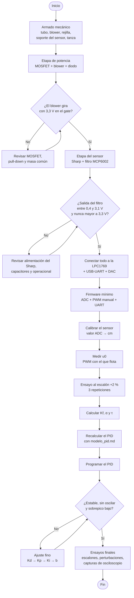
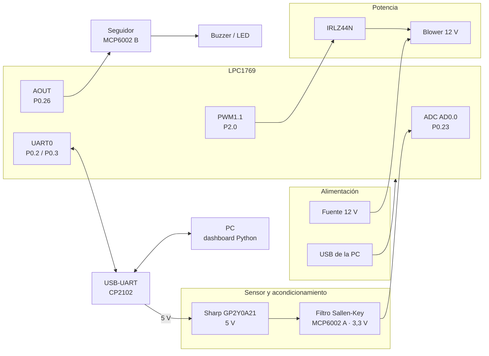

# Armado del TP

Guía para armar el levitador (estructura y circuito) y medir los parámetros reales de la planta, de manera que se pueda recalcular el PID de [modelo_pid.md](modelo_pid.md).

---

## Diagrama de flujo del armado



Regla general: **cada etapa del circuito se prueba sola antes de conectarla a la LPC1769.** Así, si algo está mal, no se arriesga la placa.

---

## Armado del hardware

### Diagrama de bloques



### Tabla de conexiones

| Señal | Pin LPC1769 | Se conecta a |
|---|---|---|
| Entrada del ADC (altura) | **P0.23** (AD0.0) | salida del filtro, a través de 1 kΩ |
| PWM del blower | **P2.0** (PWM1.1) | gate del MOSFET, a través de 220 Ω |
| Salida del DAC | **P0.26** (AOUT) | entrada + del seguidor (MCP6002 B) |
| UART TX | **P0.2** (TXD0) | RX del CP2102 |
| UART RX | **P0.3** (RXD0) | TX del CP2102 |
| 3,3 V | salida 3,3 V de la placa | alimentación del MCP6002 |
| GND | GND de la placa | **masa común** de todo el circuito |

> Ubiquen cada pin en el diagrama de pines de su placa LPCXpresso: la numeración del conector cambia según la versión.

### Alimentación

| Tensión | De dónde sale | Qué alimenta |
|---|---|---|
| 12 V | fuente externa (jack DC) | solo el blower |
| 5 V | pin **5V** del módulo CP2102 (viene del USB) | solo el sensor Sharp (~30 mA) |
| 3,3 V | salida de 3,3 V de la LPC1769 | MCP6002 |

- **Todas las masas van unidas:** fuente de 12 V, LPC1769, CP2102, sensor y operacional.
- **Los 12 V nunca tienen que tocar nada del lado de 3,3 V.** Antes de conectar la LPC, midan con el tester que no haya 12 V en ningún cable que vaya a la placa.

---

### Etapa 1 · Potencia (blower)

```text
                         +12 V
                           │
                 ┌─────────┤
                 │         │
           1N5819 ▲     ┌──┴──┐
          (cátodo │     │BLOWER│
           a +12V)│     └──┬──┘
                 │         │
                 └─────────┤ Drain
                           │
  P2.0 ──[ 220 Ω ]──┬─── Gate   IRLZ44N
                    │      │
                 [ 10 kΩ ] │ Source
                    │      │
  GND ──────────────┴──────┴──── GND (común con la fuente de 12 V)
```

- **220 Ω en el gate:** limita el pico de corriente al cargar el gate.
- **10 kΩ gate-source (pull-down):** mientras la LPC arranca o se reinicia, el pin queda flotando; esta resistencia mantiene el blower apagado.
- **Diodo 1N5819:** en paralelo con el blower, con el **cátodo (la raya) hacia +12 V**. Absorbe el pico de tensión del motor cuando el MOSFET se apaga.
- **Capacitor de 10 µF** entre +12 V y GND, cerca del blower.

**Prueba sola:** conectar el gate a 3,3 V a través de los 220 Ω (por ejemplo, desde la salida de 3,3 V de la placa) → el blower tiene que girar a pleno. Conectarlo a GND → se tiene que detener.

---

### Etapa 2 · Sensor y acondicionamiento

Filtro pasa-bajos **Sallen-Key de ganancia 1**, con la mitad A del MCP6002:

**Alimentación del sensor:**

```text
  +5 V (CP2102) ──┬────────┬──────── Vcc  ┌──────────┐
                  │        │              │  SHARP   │
               10 µF +   100 nF           │ GP2Y0A21 ├──── Vo (0,4 a 3,1 V) ──▶ al filtro
                  │        │              │          │
  GND ────────────┴────────┴──────── GND  └──────────┘
```

Los dos capacitores van **pegados al sensor**: el Sharp consume picos de corriente cada vez que pulsa su LED.

**Filtro (MCP6002, mitad A, alimentado con 3,3 V):**

```text
                            C1 = 1 µF
                 ┌─────────────┤├──────────────┐
                 │                             │
Vo ──[R1 10k]────┤ X           ┌─────────┐     │
                 │             │         │     │
                 └─[R2 10k]─┬──┤ +       │     │
                            │  │    A    ├─────┴──┬──[1 kΩ]──► P0.23 (AD0.0)
                            │ ┌┤ −       │        │
                 C2 = 1 µF ═══│└─────────┘        │
                            │ └───────────────────┘
                           GND
```

Conexiones del filtro, punto por punto:

| Componente | Entre |
|---|---|
| R1 = 10 kΩ | salida del Sharp (Vo) → nodo X |
| R2 = 10 kΩ | nodo X → entrada **+** del operacional |
| C1 = 1 µF | nodo X → **salida** del operacional |
| C2 = 1 µF | entrada **+** del operacional → GND |
| Salida del operacional | unida a su entrada **−** (seguidor) |
| 1 kΩ | salida del operacional → P0.23 |
| 100 nF | pin Vdd del MCP6002 → GND, lo más cerca posible del integrado |

**Cálculo del filtro:**

$$
f_0 = \frac{1}{2\pi R C} = \frac{1}{2\pi \cdot 10\,\text{k}\Omega \cdot 1\,\mu\text{F}} \approx 16\ \text{Hz}, \qquad Q = 0{,}5
$$

- Deja pasar el movimiento de la pelota (unos pocos Hz) y recorta los picos del Sharp, que pulsa su LED a ~1 kHz.
- Con Q = 0,5 no tiene sobrepico.
- **No hace falta ganancia:** el Sharp entrega como máximo ~3,1 V, ya dentro del rango del ADC (0 a 3,3 V).
- Como el MCP6002 se alimenta con 3,3 V, su salida **nunca puede pasar de 3,3 V**: el ADC queda protegido.
- La resistencia de 1 kΩ limita la corriente hacia el pin si algo falla.

**Presets de 10 kΩ:** con el MCP6002 no son necesarios. Quedan de reserva por si el sensor llegara a superar los 3,3 V: en ese caso se arma un divisor de tensión ajustable antes de R1.

**Prueba sola:** alimentar el Sharp y el MCP6002, mover la mano entre 10 y 80 cm del sensor y medir con el tester (o mejor, con el osciloscopio) la salida del operacional. Tiene que variar entre ~0,4 y ~3,1 V **sin pasar nunca de 3,3 V**. En el osciloscopio se ve la diferencia entre la salida del Sharp (con picos) y la del filtro (limpia): sirve como captura para el informe.

---

### Etapa 3 · Salida del DAC

Seguidor de tensión con la mitad B del MCP6002 (el mismo integrado):

```text
                    ┌───────┐
  P0.26 (AOUT) ─────┤+      │
                    │MCP6002├──┬────── Buzzer pasivo (piezo) ──── GND
                 ┌──┤−   B  │  │
                 │  └───────┘  │       o
                 └─────────────┘
                                 └──[ 330 Ω ]──▶|── GND   (LED)
```

- El seguidor evita cargar el pin AOUT.
- **Usen un buzzer piezoeléctrico** (alta impedancia). Uno magnético, de unos 16–40 Ω, pide más corriente de la que entrega el MCP6002 (~20 mA). En ese caso hace falta un transistor.
- Si no usan la mitad B, conecten su entrada + a GND y su salida a la entrada − para que no oscile.

---

### Etapa 4 · Comunicación UART

```text
  LPC1769                 CP2102
  P0.2 (TXD0) ──────────▶ RX
  P0.3 (RXD0) ◀────────── TX
  GND ─────────────────── GND
                          5V ────▶ alimentación del Sharp
```

- **TX va a RX y RX va a TX** (cruzados).
- El CP2102 tiene que trabajar con lógica de **3,3 V**. Si tiene un selector o un jumper, pónganlo en 3,3 V.
- No conecten el pin 3V3 del CP2102 a la LPC: la placa se alimenta por su propio USB.

---

### Estructura mecánica

```text
            ┌───────┐
            │ SHARP │   ← soporte (listón, cartón grueso o impreso 3D)
            └───┬───┘     el sensor mira hacia abajo, centrado
                │
                │   10–12 cm libres (zona ciega del Sharp)
                │
          ──────┼──────  ← cruz de tanza en el borde superior del tubo
          │     │     │
          │     ▼     │
          │           │
          │     ●     │  ← pelota (40 mm)
          │           │
          │   tubo    │  50–80 cm de largo
          │  Ø 45–50  │
          │    mm     │
          │           │
          │     ▲     │
          ├───────────┤  ← rejilla de cooler
          │  BLOWER   │  ← con un cono o adaptador que lleve todo el aire al tubo
          └───────────┘
       ════════════════════  base firme (madera)
```

- **El tubo tiene que estar vertical.** Si está inclinado, la pelota roza las paredes y el control empeora.
- **Sin fugas entre el blower y el tubo:** sellen con cinta o silicona. Las fugas cambian el caudal y el modelo.
- **Sensor centrado** sobre el eje del tubo, mirando hacia abajo.
- **Base pesada o atornillada:** el blower vibra y puede mover el conjunto.
- **Cables del blower separados de los del sensor:** el PWM genera ruido que se puede acoplar a la señal analógica.

---

## Qué hay que medir

La función de transferencia de la planta es:

```text
         Kf·α
G(s) = ─────────────────────── · e^(−θs)        y el PWM de equilibrio u0
       s · (s + α) · (τs + 1)
```

Hay que medir **4 cosas**: u0, Kf, α y τ. La masa de la pelota, su diámetro y el coeficiente de arrastre no se miden por separado: su efecto ya queda incluido en esas cuatro mediciones.

**θ (retardo)** no hace falta medirlo: sale del período de actualización del Sharp (~40 ms), que está en la hoja de datos.

---

## Paso previo: calibrar el sensor

Antes de cualquier otra medición, el Sharp tiene que dar la altura en cm. Si no, el resto de las mediciones no sirve.

1. Poner la pelota a alturas conocidas, medidas con una regla, cada 5 cm en todo el rango del tubo.
2. En cada altura, anotar el valor del ADC (promedio de varias lecturas).
3. Armar la tabla o ajustar una curva que convierta el valor del ADC en cm.

| Altura [cm] | Valor ADC | Tensión [V] |
|---|---|---|
| | | |
| | | |
| | | |

> La curva del Sharp **no es lineal**. Conviene usar una tabla con interpolación lineal entre puntos.

---

## Las 4 mediciones

| # | Qué se mide | Variable | Cómo | Qué cambia en el cálculo |
|---|---|---|---|---|
| 1 | **PWM con el que la pelota flota** | **u0** | En modo manual, subir el PWM de a poco hasta que la pelota quede quieta. | El punto de partida del PID. Si está mal, el integrador tarda en corregirlo. |
| 2 | **Velocidad de subida tras un escalón chico de PWM** | **Kf** | Desde u0, subir el PWM un 2%. La pelota termina subiendo a velocidad constante: medir esa velocidad con los datos de la UART. `Kf = velocidad / 0,02` | La ganancia de la planta. Es la que más afecta la estabilidad. |
| 3 | **Cuánto tarda la pelota en llegar a esa velocidad** | **α** | Con el mismo ensayo, medir el tiempo hasta que la velocidad llega al 63% de la final. `α = 1 / ese tiempo` | El polo "lento" de la pelota. |
| 4 | **Cuánto tarda el blower en acelerar** | **τ** | Si el blower tiene cable de tacómetro: medir cuánto tardan las RPM en llegar al 63% del cambio ante un escalón de PWM. Si no: medir cuánto tarda la pelota en empezar a moverse después del escalón. | El polo del ventilador. Es lo que limita qué tan rápido puede ser el control. |

### Unidades

Para usar los valores en [modelo_pid.md](modelo_pid.md), la velocidad va en **m/s** y el escalón de PWM como fracción (2% = 0,02). Ejemplo: si la pelota sube a 15 cm/s → `Kf = 0,15 / 0,02 = 7,5 (m/s) por unidad de PWM`.

---

## Ensayo al escalón (mediciones 2, 3 y 4)

Las mediciones 2, 3 y 4 salen **de un mismo ensayo**:

1. Poner la pelota flotando en u0, en modo manual, cerca de la parte baja del tubo (así tiene recorrido para subir).
2. Subir el PWM un 2% de golpe.
3. Registrar la altura cada 40 ms por la UART durante unos 3 segundos, o hasta que la pelota llegue arriba.
4. En la PC:
   - graficar la altura contra el tiempo;
   - calcular la velocidad (diferencia de altura entre muestras / 0,04 s) y suavizarla con un promedio móvil, porque el Sharp es ruidoso;
   - sacar la velocidad final (→ Kf), el tiempo al 63% (→ α) y el retraso inicial (→ τ).
5. Repetir **3 veces** y promediar.

### Registro de resultados

| Ensayo | u0 [%] | Velocidad final [cm/s] | Tiempo al 63% [s] | Retraso inicial [s] |
|---|---|---|---|---|
| 1 | | | | |
| 2 | | | | |
| 3 | | | | |
| **Promedio** | | | | |

| Parámetro | Valor supuesto | Valor medido |
|---|---|---|
| u0 | 50% | |
| Kf | 17,3 (m/s)/u | |
| α | 2,27 s⁻¹ | |
| τ | 0,40 s | |

---

## Instrumentos

- La propia **LPC1769 con la UART**, para registrar la altura.
- Una **regla**, para calibrar el sensor.
- Un **tester**, para probar cada etapa antes de conectarla.
- Un **osciloscopio**, para ver el filtro, el PWM y el DAC, y el cable del tacómetro si el blower lo tiene (para medir τ).

---

## Después de medir

1. Reemplazar los valores en la tabla de la [sección 4 de modelo_pid.md](modelo_pid.md#4-valores-numéricos).
2. Recalcular G(s) y repetir el diseño del PID.
3. Programar el PID con las ganancias nuevas y hacer el ajuste fino en el equipo ([sección 7 de modelo_pid.md](modelo_pid.md#ajuste-fino-en-el-equipo)).
